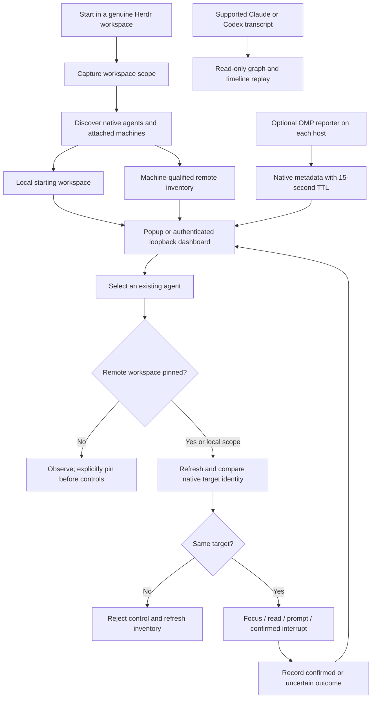
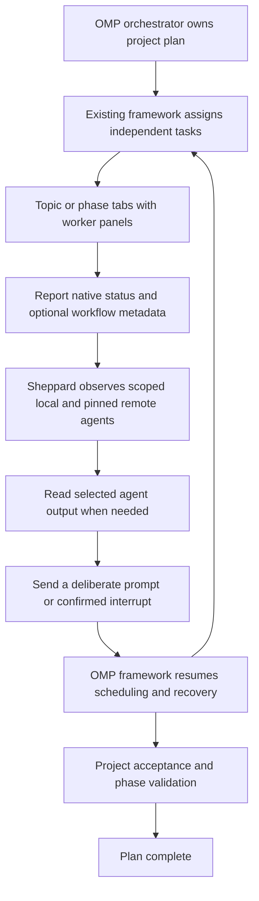
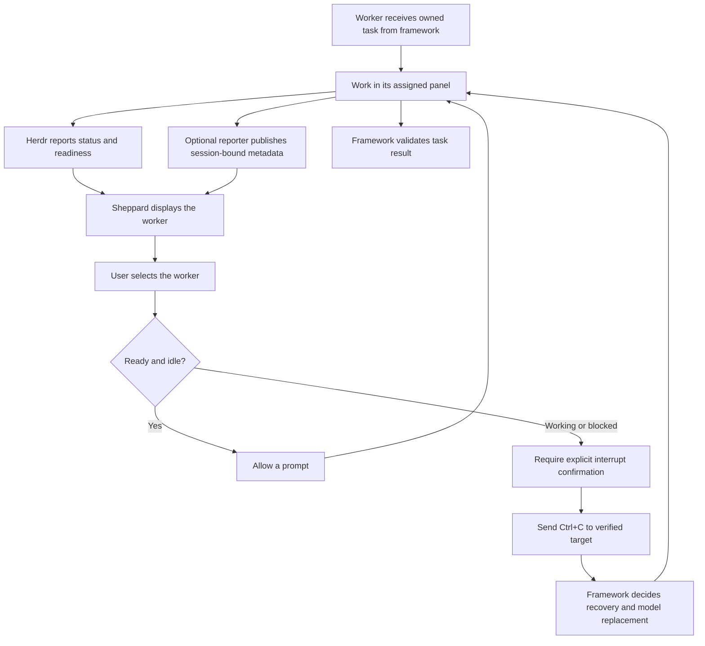

# herdr-sheppard

Herdr worker and orchestrator manager, forked from [Zoetrope](https://github.com/furkankly/zoetrope). The popup, browser dashboard and native session graph use OMP's Titanium palette: electric blue, brushed titanium backgrounds, aluminum text and dense monospace controls.

Sheppard works in the Herdr workspace where you start it. It discovers attached remote machines through Herdr, groups agents by machine, workspace and tab, and exposes focus, output reading, prompts and confirmed interruption. The optional OMP reporter adds model, task, phase, parent and cached workflow metadata. Sheppard makes no AI calls.

## Install

Requires Python 3 and Herdr 0.9.3 or later on macOS or Linux. Run registration from a genuine Herdr terminal:

```sh
git clone https://github.com/bloodf/herdr-sheppard
cd herdr-sheppard
herdr plugin link "$PWD/herdr-plugin"
```

Choose **Sheppard: orchestrators and workers** for the popup or **Sheppard: browser dashboard** for the browser view. The dashboard binds to loopback on its host and prints an authenticated URL. A server launched remotely needs access through that host's browser or a deliberate local tunnel. It does not expose a public listener.

The manager works without Rust, OMP or Laya. Build the optional transcript viewer with Rust 1.88 or later:

```sh
cargo build --release --locked --bin sheppard
./target/release/sheppard --help
./target/release/sheppard recording.jsonl
```

Graph actions use this fork's binary. An explicitly configured `SHEPPARD_BIN` can select another build of the fork. They never silently install or invoke upstream `zoe`.

For optional OMP metadata, build `manager/dist/reporter.js` with `bun install --frozen-lockfile && bun run build` in `manager/`, then link that package using OMP's package support. See [manager installation and controls](manager/README.md), [native plugin actions](herdr-plugin/README.md) and the optional host installer `manager/install.py --help`.

## What each view supports

| View | Inputs | Behavior |
| --- | --- | --- |
| Popup and fleet dashboard | Native Herdr agents, attached machines, optional OMP metadata | Observe and control existing orchestrators and workers |
| Native graph and browser replay | Claude Code and Codex transcripts | Inherited Zoetrope agent graph, tool activity and timeline replay |
| OMP workflow metadata | Optional reporter reading the existing workflow database | Role, model, task, phase, parent and cached health |

OMP/Pi transcripts are not supported by the inherited graph parser. Their agents remain available in the fleet manager. Cached DurinDoor health is not a remaining-quota measurement. Project Laya counters are project-wide, not per-worker. Quota fetching, model fallback, task scheduling and PR integration belong to the orchestration framework, rather than this UI plugin.

## Workflow



## Orchestrator workflow



## Worker workflow



## Safety and evidence

Remote commands always carry the saved machine's opaque ID. A failed remote lookup never falls back to the local machine. Controls require current native workspace, pane, terminal and session identity. A selection is cleared when its target disappears or changes. Uncertain control results are never automatically replayed.

The browser server uses a capability token, exact Host/Origin checks, bounded requests and timeouts. Output is read on demand and common secrets are redacted. Metadata expires; missing evidence appears as unknown. No provider credentials are published to the dashboard.

Fixture tests validate these boundaries without controlling real sessions. Registration and attached-remote operation need a smoke test inside genuine Herdr before treating the integration as live-validated.

## Development

```sh
cargo fmt --all --check
cargo test --locked --all-features
cargo clippy --all-targets --all-features -- -D warnings
cd manager
python3 -m unittest test_crew.py test_install.py
node test_dashboard.cjs
node test_auth.cjs
python3 ../herdr-plugin/test_bridge.py
bun install --frozen-lockfile
bun run check
bun run test:reporter
```

The browser replay is built separately with `bash web/scripts/build-wasm.sh`, requiring `trunk` and the `wasm32-unknown-unknown` Rust target. In `web/`, `pnpm install --frozen-lockfile && pnpm run build` builds WASM and the static site. `build:site` alone does not build the replay module. Fonts are local monospace fallbacks; analytics are disabled.

## Attribution

MIT licensed. Original Zoetrope copyright remains in [LICENSE](LICENSE). [NOTICE](NOTICE) records fork and OMP palette attribution. Upstream architecture and provider behavior remain documented in [docs/ARCHITECTURE.md](docs/ARCHITECTURE.md) and [docs/DESIGN.md](docs/DESIGN.md). The internal Rust library and WASM export names retain `zoetrope` for compatibility. [Original upstream README](docs/UPSTREAM-README.md) and demo recordings are retained as upstream references; recordings show the original gold UI.

Inherited website deployment, crates.io publishing and upstream Homebrew updates are archived as reference text in `docs/upstream-workflows/`. This fork does not run those release operations.
