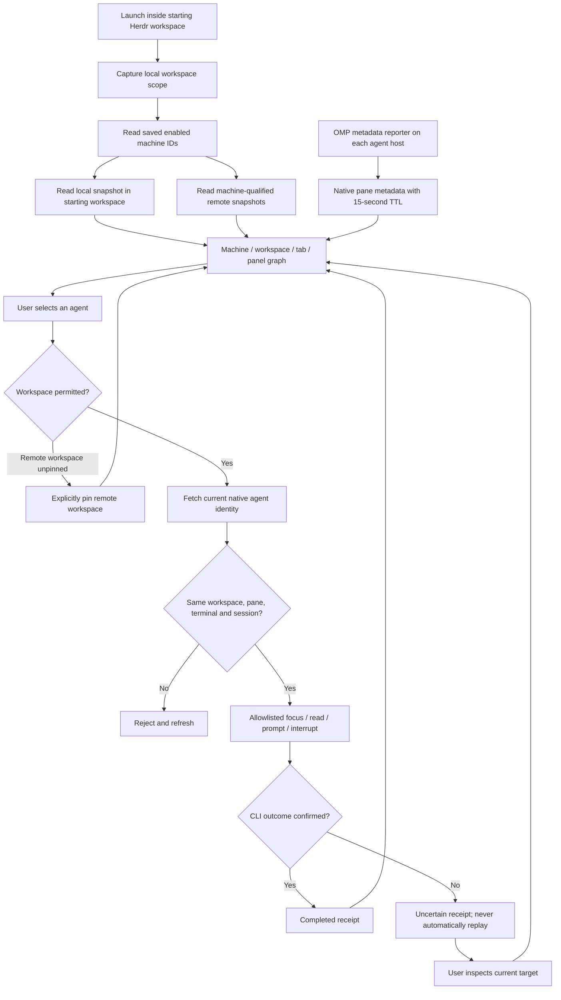
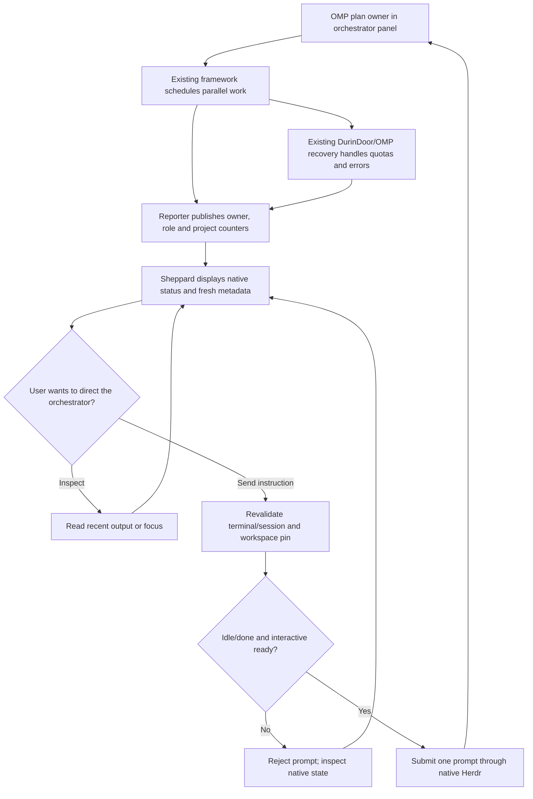
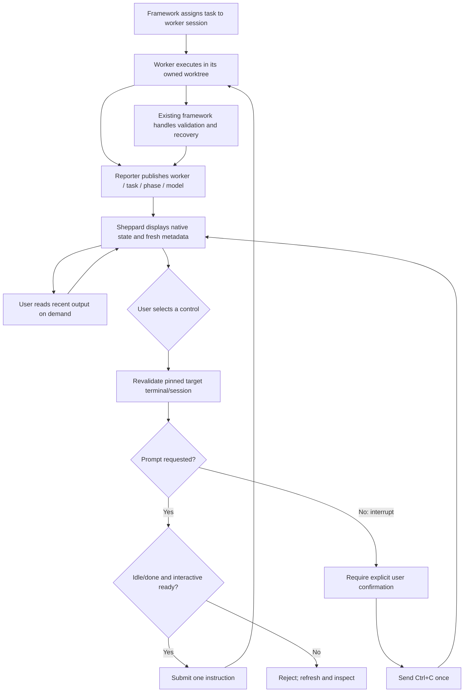

# herdr-sheppard

Open-source Herdr plugin, licensed under [MIT](LICENSE). The Python controller and browser dashboard work without OMP or Laya. The optional OMP reporter adds framework metadata when that workflow exists.

## Standalone installation

Clone this repository, then run `herdr plugin link /absolute/path/to/herdr-sheppard/herdr-plugin`. Python 3 and Herdr 0.9.3 are required. The controller uses only the Python standard library; the browser uses no external libraries or services. Choose **Sheppard: orchestrators and workers** or **Sheppard: browser dashboard** from Herdr’s plugin actions. The optional reporter and personal OMP installer are separate from standalone Herdr installation.

## Building the optional reporter

In this directory, `bun install` installs build dependencies and `bun run build` produces `dist/reporter.js`. The source has no imports from the parent framework. The reporter expects its documented OMP/Laya SQLite state schema; missing or disabled state means native Herdr information remains available without framework metadata.

Sheppard is a Herdr plugin for observing orchestrators, workers, and saved remote machines from the workspace where you start it. The terminal popup gives a compact live list; the browser dashboard groups panels by machine, workspace, and tab and shows reported parent relationships.

Sheppard makes no model calls. OMP and the Laya framework retain task assignment, model routing, recovery, PR integration, and project state. Sheppard reads native Herdr state and optional OMP metadata and sends a small set of deliberate controls through Herdr's CLI.

## Starting and using Sheppard

Launch Sheppard from the intended workspace with Herdr's plugin action **Sheppard: orchestrators and workers**. Its `open` action opens the plugin's `crew` popup pane in the captured starting workspace. Python 3 and Herdr 0.9.3 or newer are required on macOS or Linux.

The plugin must receive real `HERDR_ENV=1` and Herdr connection context. Workspace scope comes from native `HERDR_PLUGIN_CONTEXT_JSON.workspace_id` for plugin invocations, or the managed terminal’s `HERDR_WORKSPACE_ID`. A popup refuses a captured scope that differs from its actual native invocation context. Do not set those variables yourself to imitate a running session. Outside Herdr, the launcher exits without sending a Herdr command. Plugin registration can run outside Herdr as a host configuration operation. The popup and browser launcher require genuine Herdr context. Fixture tests do not prove connectivity to a real remote server.

The terminal popup refreshes its inventory while open. Select a row with `j`/`k` or arrow keys:

| Key | Action |
| --- | --- |
| `f` | Focus the selected agent through Herdr |
| `r` | Read up to 80 recent unwrapped output rows; press a key to return |
| `p` | Send a prompt to a ready idle/done agent |
| `i` | Send Ctrl+C to a working/blocked agent after typing `yes` |
| `s` | Pin the selected remote workspace for controls |
| `q` or Escape | Close the popup |

Use **Sheppard: browser dashboard** to start the local HTTP dashboard server. Its short action opens a native server tab; that tab prints a URL containing a private capability in the fragment. Open that exact URL on the server's host. The server binds only to `127.0.0.1` on an ephemeral port; starting it on a remote host does not expose a public dashboard. `HERDR_CREW_BROWSER=1` optionally requests the host's browser to open the URL. Keep the server tab running while using the dashboard.

The dashboard provides Refresh, workspace pins, selected-agent details, Focus, Read output, Send prompt, and a confirmed Interrupt for working/blocked agents. It polls every five seconds with backoff after failures. Selections and drafts are bound to the agent identity; replacement or disappearance clears them and requires explicit reselection. Popup selection follows the same identity across inventory reordering. The capability is stored only in the current browser tab, scoped to its server origin, so reload works; rejected credentials or unavailable storage show a reauthentication notice. The backend coalesces inventory requests and caches snapshots for two seconds. Terminal output is fetched only when requested, with ANSI escapes removed and obvious bearer tokens and API keys redacted.

## Machines and workspace scope

Sheppard obtains saved enabled machines from `herdr machine list --json` and reads each snapshot using its opaque machine ID. At most four snapshot commands run concurrently, each with a five-second timeout. A remote failure remains attached to that machine; Sheppard never substitutes a local snapshot or sends its control locally.

The local machine shows only the starting workspace. Remote workspace inventory is initially read-only. Select and pin a remote workspace before controlling its agents. Pins are explicit per machine and last for the controller process. Identical workspace, tab, or pane IDs on different machines remain distinct through machine-qualified keys. Changing a pin disables controls for the previous workspace.

## What the graph reports

The OMP reporter reads the existing project workflow database without writing it. It publishes metadata only when the workflow is enabled, its configured workspace matches the real Herdr workspace, and the OMP actor has a registered workflow session. It reports every five seconds, also after an agent turn ends, using native `pane report-metadata` with a 15-second TTL. Reporter failures do not stop project execution. Nested OMP sessions (`OMPCODE=1`) and non-main agent contexts do not publish over the native panel owner.

| Field | Meaning |
| --- | --- |
| Role | `orchestrator` for the plan owner, `worker` for an owned assigned task, otherwise `unassigned` |
| Owner / parent | Workflow actor identity and reported plan-owner relationship |
| Model | Current OMP provider/model identifier |
| Task / phase | Currently owned task and phase, when assigned |
| Quota metadata | Cached DurinDoor gateway-session health/status; **not remaining quota** |
| Project Laya / project cache | Project-wide recorded Laya calls and cache hits; **not per-worker usage** |
| Updated | Reporter timestamp |
| Status / readiness | Native Herdr agent status and `interactive_ready` |

Metadata older than 15 seconds becomes `unknown`. A native session ID must match the reported ID, or its file path must match the reporter’s SHA-256 path hash, before metadata is displayed. Missing or unsupported native session references remain unknown; raw session file paths are not published. Missing reporters or stale data do not imply that an agent stopped, failed, or completed work. Parent edges appear only for an unambiguous reported owner within the same machine and workspace.

Native `done` means a settled agent whose completion has not been marked seen by Herdr. It does not mean a task was accepted, a PR merged, or the phase validated. Focusing an agent can change Herdr's seen state while preserving the agent's identity.

## Orchestrator workflow

Sheppard makes the existing orchestrator visible and controllable. To request more workers or change the plan, prompt the ready orchestrator; the existing OMP/Laya workflow owns those operations. Sheppard does not independently assign tasks, choose models, spawn workers, or merge PRs.

## Worker workflow

Each worker remains a real OMP session in its own panel. The controller displays its assignment and native state and allows inspection without consuming model tokens. Sending a prompt can cause the worker's harness to call its configured model; that model call belongs to OMP, not Crew.

## Control and recovery boundaries

Before any agent control, Sheppard fetches `agent get` and checks the selected workspace, pane, terminal, and available session reference against the snapshot-bound identity. Ordinary revisions and metadata updates do not invalidate identity. This is a fresh preflight check; the native CLI does not provide an atomic identity compare-and-send transaction.

Prompts require a native idle/done state and `interactive_ready=true`. Busy or blocked agents reject prompts. Interrupt sends only Ctrl+C after confirmation. There are no arbitrary shell commands, pane closures, server stops, worktree creation, model selection, task assignment, or merges in this controller.

Each action requires a unique request ID. Sheppard reserves it before sending a command. A failed or timed-out command becomes `uncertain`; retrying the same ID returns the recorded result rather than replaying it. A conflicting payload with that ID is rejected. Receipts last only for the controller process, with a 4,096-action limit; they are not a durable cross-restart delivery ledger. Inspect unresolved actions before restarting or explicitly issuing a new control.

The HTTP API requires the private capability on every API request, an exact local Host, and a matching Origin for POST requests. It accepts only JSON bodies up to 16 KiB, uses five-second socket timeouts, emits no CORS grants, and does not include SSH targets, raw native session paths, or raw snapshots in the public graph. Terminal-output redaction recognizes common secret formats; requested terminal text still deserves the same privacy as the terminal itself.

## Validation scope

Backend tests use a fixture runner, a temporary fake Herdr executable, and an isolated localhost HTTP server. They cover duplicate remote IDs, machine failures, malformed inventory, workspace pins, replacement identities, prompt readiness, retry prevention, telemetry expiry, redaction, and HTTP capability/origin/body checks. They send no commands to the user's Herdr. Live native plugin registration, real attached remote connectivity, and an active multi-worker pilot require separate runtime verification inside Herdr.

## Personal OMP stack installation

## Building and installation

From `manager/`, run `bun install --frozen-lockfile`, `bun run check`, and `bun run build` to build the optional OMP metadata reporter. The Python manager itself needs no Rust build.

After the existing OMP/Laya framework, Pi adapter, and Laya skills package are present, `python3 manager/install.py` stages this manager together with `herdr-plugin/`, probes actual OMP extension loading without model requests, backs up OMP registration files, and enables the reporter. The stable root is `~/.omp/agent/lib/herdr-sheppard`. New OMP sessions load the reporter; existing sessions are not restarted. Register the native plugin with `herdr plugin link ~/.omp/agent/lib/herdr-sheppard/herdr-plugin --enabled` on each host. Its popup and dashboard actions run inside a genuine Herdr workspace.

The unified plugin's `open` and `browser` actions manage OMP workers through native Herdr state. Its distinct `graph-open`, `graph-split`, and `graph-tab` actions use the inherited transcript visualization for **Claude Code and Codex only**. OMP/Pi transcript parsing is not provided; those sessions use the worker manager instead. Build the fork graph with `cargo build --release --bin sheppard` from the repository root, or explicitly select a built executable through `SHEPPARD_BIN`. No stock `zoe` binary is installed or launched. An absent graph binary does not prevent the Python manager from running.
